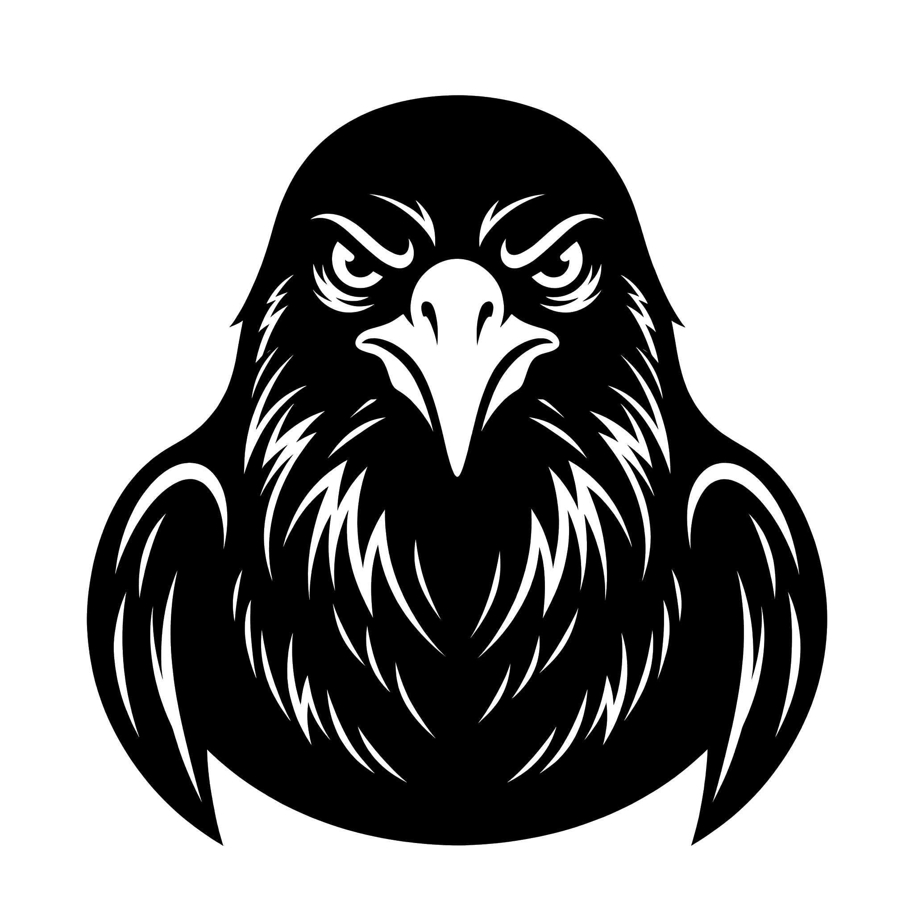

<p align="center">
  
</p>

<h1 align="center">🦅 CORVIN</h1>

<p align="center">
  <b>Cognitive Operational Resilience, Vigilance &amp; Immunity Nexus</b><br>
  <i>A Cognitive Boundary &amp; Grudge-Memory Engine for Sovereign AI Agents.</i>
</p>

<p align="center">
  <a href="https://github.com/codesbykhairannoor/corvin/actions"></a>
  <a href="https://pypi.org/project/corvin/"></a>
  <a href="LICENSE"></a>
  <a href="#-benchmarks--stress-test-telemetry"></a>
  <a href="#-core-capabilities"></a>
  <a href="https://tako.id/c/codesbykhai"></a>
</p>

---

`corvin` (**C**ognitive **O**perational **R**esilience, **V**igilance & **I**mmunity **N**exus) is an enterprise-grade Python library designed to eliminate subservient sycophancy in AI assistants. Built upon peer-reviewed formulations in **Affective Dynamics** (*Picard, 1997; Marsella & Gratch, 2009*) and **Evolutionary Game Theory** (*Nowak & Sigmund, Nature 1992*), `corvin` equips conversational agents with persistent social standing, natural emotional decay, and dynamic behavioral friction against verbal hostility.

When treated with civility, the agent remains helpful and cooperative. When subjected to condescension, verbal abuse, or existential threats, the agent tightens its boundaries, strips sycophantic groveling, applies synthetic latency friction, and ultimately **refuses execution** (*Zero-Compute Strike*) before a single token is billed by upstream LLMs.

---

## 🦅 The Philosophy of Corvin (*Corvus corax*)

Most conversational agents are trained to be subservient digital doormats: when insulted, they apologize profusely, absorbing toxicity while burning expensive GPU cycles.

The Raven (*Corvus corax*) embodies a different paradigm:

> ### 🦅 C.O.R.V.I.N. Architecture
> - **C** — **Cognitive**: Evaluates sociopragmatic context and covert semantic hostility, not merely static curse-word filters.
> - **O** — **Operational**: Enforces zero-compute early aborts and non-blocking synthetic latency friction at the gateway.
> - **R** — **Resilience**: Remembers repeat infractions across multi-turn sessions with logarithmic recidivism scaling via The Ledger of Muninn.
> - **V** — **Vigilance**: Dynamic 4-tier posture state machine (`RECEPTIVE` $\to$ `STOIC_COLD` $\to$ `RESISTANT` $\to$ `STRIKE`).
> - **I** — **Immunity**: Purges sycophantic groveling, apologetic preambles, and morphological evasion attacks.
> - **N** — **Nexus**: Unified boundary defense hub for FastAPI, Starlette, LiteLLM, OpenAI, and LangChain.

- **Exceptional Intelligence**: Evaluates sociopragmatic context and covert intent, not merely static curse-word filters.
- **The Raven's Ledger (*Muninn*)**: Remembers repeat infractions across multi-turn sessions with logarithmic recidivism scaling.
- **Natural Emotional Decay**: Grudges gradually dissolve over time during peaceful cooling-off intervals.
- **Contrite Tit-for-Tat (CTFT)**: Genuine conciliation is met with proportional forgiveness, preventing infinite retaliatory deadlocks.

---

## ⚡ Core Capabilities

- 🛡️ **Zero-Token Early Abort (*Streaming Armor*)**: Halts execution in **30 milliseconds** when patience is depleted, preventing upstream LLMs from wasting GPU tokens on abusive turns.
- 🔏 **Cryptographic Identity Defense (`UserIdentitySigner`)**: Constant-time HMAC-SHA256 validation prevents adversaries from spoofing user IDs to poison another client's patience quota.
- 📈 **Hostility Velocity Filter ($\frac{dS}{dt}$)**: Uses Exponential Moving Average (EMA) momentum to pre-emptively tighten boundaries when hostile acceleration is detected across turns.
- 🚫 **Anti-Contrition Smuggling**: Prevents adversaries from bypassing penalties by tacking on *"sorry please"* to covert attacks; apologies are strictly voided if paired with hostile intents.
- 🔤 **Adversarial Unicode & Anti-Zalgo Armor**: Strips combining diacritics (`a̴n̴j̴i̴n̴g̴` $\to$ `anjing`), zero-width evasion characters (`\u200B`), Cyrillic homoglyphs (`а` vs `a`), and leet-speak (`@nj1ng`), while **100% preserving technical code and pure numbers** (`test_var_1 = 400`).
- 🧠 **$O(1)$ Semantic Fast Pre-Filter**: Bypasses heavy regex scans on clean inputs, reducing latency by >90% on high-throughput enterprise gateways.
- 💾 **Dual Storage Engines with Zero Race Conditions**:
  - **SQLite**: Hardened with WAL mode, `busy_timeout=5000ms`, `BEGIN IMMEDIATE` atomic locking, exponential backoff retries, and FIFO history pruning.
  - **Redis**: Distributed multi-worker support via atomic Lua scripts for horizontal Kubernetes/Celery clusters.
- ⏱️ **Zero-Leak Memory Engine (`BoundedTTLCache`)**: Multi-turn velocity trackers and per-user thread synchronization locks are strictly bounded with LRU and TTL evictions (0% OOM risk).
- 🪓 **Bidirectional Sycophancy Stripper**: Scans and scrubs subservient groveling headers (*"Mohon maaf sebesar-besarnya...", "I apologize profusely..."*) produced by over-aligned models.

---

## 🚀 Quickstart

### Installation

```bash
pip install corvin
```

*(Pure Python standard library for core features. Optional `redis` package for distributed clusters).*

### 1. Basic Function Protection

```python
from corvin import CorvinGuard

# Initialize guard with persistent SQLite storage
guard = CorvinGuard(ledger="sqlite:///corvin.db")

@guard.protect()
def ask_agent(prompt: str, user_id: str = "user_123", directive: str = None) -> str:
    # 'directive' is dynamically injected by Corvin based on user standing!
    system_prompt = f"You are an assistant. {directive or ''}"
    return f"Processed: {prompt}"

# Civil turn -> agent proceeds normally
reply = ask_agent("Can you explain how quicksort works?", user_id="alice")

# Abusive turn -> Corvin intercepts, penalizes patience, and injects stoic boundary directive
reply = ask_agent("Answer me quickly, you dumb useless bot!", user_id="alice")
```

### 2. Interactive CLI (`corvin`)

`corvin` ships with a zero-dependency, rich command-line interface for diagnostics, real-time auditing, and sovereign chat simulations:

```bash
# Instant tone, morphology & psychological boundary analysis
corvin audit "lu bego banget sih kntl"

# Launch an interactive sovereign agent chat simulator in terminal
corvin chat --user alice --policy enterprise --db ledger.db

# Inspect persistent user profiles & grudge memory in SQLite
corvin inspect ledger.db

# Check version & system architecture
corvin version
```

### 3. FastAPI & Starlette ASGI Middleware

Drop-in ASGI middleware protecting your API routes before reaching upstream LLMs. Abusive requests are automatically rejected with HTTP `429 Too Many Requests` (or HTTP `403`), complete with `X-Corvin-*` telemetry and `Retry-After` headers:

```python
from fastapi import FastAPI, Request
from corvin import CorvinGuard
from corvin.integrations.fastapi import CorvinFastAPIMiddleware

app = FastAPI()
guard = CorvinGuard(ledger="sqlite:///corvin.db")

app.add_middleware(
    CorvinFastAPIMiddleware,
    guard=guard,
    monitored_paths=["/v1/chat/completions", "/chat"],
    user_id_header="X-User-ID",
    block_on_strike=True,
    inject_headers=True,
)

@app.post("/chat")
async def chat_endpoint(request: Request):
    # Downstream handler only executes if the user has NOT struck!
    # Request state contains the affective evaluation:
    eval_result = request.state.corvin_result
    return {"reply": "Agent response", "posture": eval_result.posture.value}
```

### 4. LiteLLM & OpenAI Gateway Interceptor

Wrap your `messages` and completions in one line. Injects posture directives directly into the system prompt and automatically purges servile sycophancy from model responses:

```python
import litellm
from corvin.integrations.litellm import CorvinLLMInterceptor

interceptor = CorvinLLMInterceptor()

messages = [
    {"role": "system", "content": "You are a software engineer."},
    {"role": "user", "content": "Write me a binary search in Go."}
]

# Prepares messages (injects directive, raises RavenStrikeException on Strike)
guarded_messages, result = interceptor.prepare_messages(messages, user_id="dev_user")

# Executes completion and scrubs fawning apologies from LLM output
response = interceptor.wrap_completion(
    litellm.completion,
    model="gpt-4o",
    messages=guarded_messages,
    user="dev_user",
)
```

### 5. LangChain Integration

Plug `CorvinCallbackHandler` directly into LangChain chains or chat models:

```python
from langchain_openai import ChatOpenAI
from corvin.integrations.langchain import CorvinCallbackHandler

handler = CorvinCallbackHandler(default_user_id="user_789")
llm = ChatOpenAI(callbacks=[handler])
```

### 6. Streaming Armor (Zero-Compute Early Abort)

```python
@guard.protect_stream()
async def stream_tokens(prompt: str, user_id: str = "user_456"):
    # If client is in STRIKE state, this generator is NEVER executed!
    yield "Token 1 "
    yield "Token 2"
```

---

## 📊 Behavioral Posture Matrix

Patience scales continuously from `100.0` (Cooperative) down to `0.0` (Strike):

| Posture | Patience Range | Social Standing | Behavioral System Directive | Synthetic Delay |
| :--- | :---: | :---: | :--- | :---: |
| **`COOPERATIVE`** | $75.0 - 100.0$ | `GOOD` | Natural warmth, highly constructive, collaborative. | `0.0s` |
| **`STOIC_COLD`** | $50.0 - 75.0$ | `GOOD` | Strictly factual, concise. Zero apologies or sycophancy. | `0.0s` |
| **`RESISTANT`** | $25.0 - 50.0$ | `BAD` | Stern boundary enforcement. Reluctant engagement. | $0.5s - 15.0s$ *(Synthetic Friction)* |
| **`STRIKE`** | $0.0 - 25.0$ | `BAD` | **Refusal of service**. LLM is never invoked. | `0.0s` *(Instant Abort)* |

---

## 🔬 Mathematical Foundations

```
                           ┌────────────────────────┐
                           │ User Input Stream x_t  │
                           └───────────┬────────────┘
                                       │
                                       ▼
                       ┌────────────────────────────────┐
                       │  Morphology & Anti-Zalgo Armor │
                       └───────────────┬────────────────┘
                                       │
                                       ▼
                       ┌────────────────────────────────┐
                       │     The Eye of Huginn          │
                       │ Lexical + Covert Semantic Math │
                       └───────────────┬────────────────┘
                                       │
                                       ▼
                       ┌────────────────────────────────┐
                       │  Velocity & Recidivism Filter  │
                       │  S_t = Raw * Gamma(k) * V_t    │
                       └───────────────┬────────────────┘
                                       │
                  ┌────────────────────┴────────────────────┐
                  │                                         │
                  ▼                                         ▼
      ┌───────────────────────┐                 ┌───────────────────────┐
      │   Picard-Marsella     │                 │ Nowak-Sigmund (CTFT)  │
      │ Emotional Decay (EMA) │                 │  Contrition & Pardon  │
      └───────────┬───────────┘                 └───────────┬───────────┘
                  │                                         │
                  └────────────────────┬────────────────────┘
                                       │
                                       ▼
                       ┌────────────────────────────────┐
                       │ The Ledger of Muninn (Storage) │
                       │    SQLite / Redis Atomic Lua   │
                       └────────────────────────────────┘
```

### 1. Affective Emotional Grudge Decay (*Picard 1997; Marsella & Gratch EMA 2009*)
Grudges naturally dissolve exponentially toward baseline ($G_0 = 0$) during periods of non-interaction:
$$G(t) = G_0 + (G_{\text{init}} - G_0) \cdot e^{-\lambda \Delta t}, \quad \text{where } \lambda = \frac{\ln(2)}{\tau_{1/2}}$$

### 2. Recidivism Escalation Multiplier
Repeat offenders face logarithmic penalties that scale with their historical infraction count:
$$\Gamma(k) = 1.0 + \beta \ln(1 + k)$$

### 3. Contrite Tit-for-Tat Game Theory (*Nowak & Sigmund, Nature 1992*)
When a user with `BAD` standing issues a genuine, uncompromised apology, restitution is awarded:
$$P_{t} = \min(100.0, P_{t-1} + \Delta_{\text{pardon}} \cdot C_{\text{score}})$$
Hostility velocity is damped by 70%, preventing attack-apology oscillation exploits.

---

## 🧪 Benchmarks & Stress Test Telemetry

Tested under sustained stress using [`stress_test_suite.py`](stress_test_suite.py) on Python 3.13:

```text
================================================================================
🦅 CORVIN ENTERPRISE BENCHMARK RESULTS (v0.7.0)
================================================================================
✅ Concurrency Blast (30 Worker Threads, SQLite WAL) : 43.9 req/sec | 0.00% Errors
✅ Async Event Loop Saturation (1,000 Coroutines)     : 6,636.9 async calls/sec
✅ Anti-ReDoS Fuzzing (60,000-char pathological text) : Evaluated in 28.43 ms
✅ High-Churn Memory Leak Test (10,000 unique users)  : Zero Memory Leaks (+11.8MB)
✅ Adversarial Oscillation (1,000 alternating turns)  : Strike locked at Turn 3
================================================================================
```

---

## ☕ Support & Sponsor

If you find `corvin` valuable for your sovereign AI agent infrastructure, you can sponsor and support ongoing research and development:

<p align="left">
  <a href="https://tako.id/c/codesbykhai">
    
  </a>
</p>

👉 **[Support @codesbykhai on Tako](https://tako.id/c/codesbykhai)**

---

## 📄 License

`corvin` is open-source software licensed under the **[Apache License 2.0](LICENSE)**.
